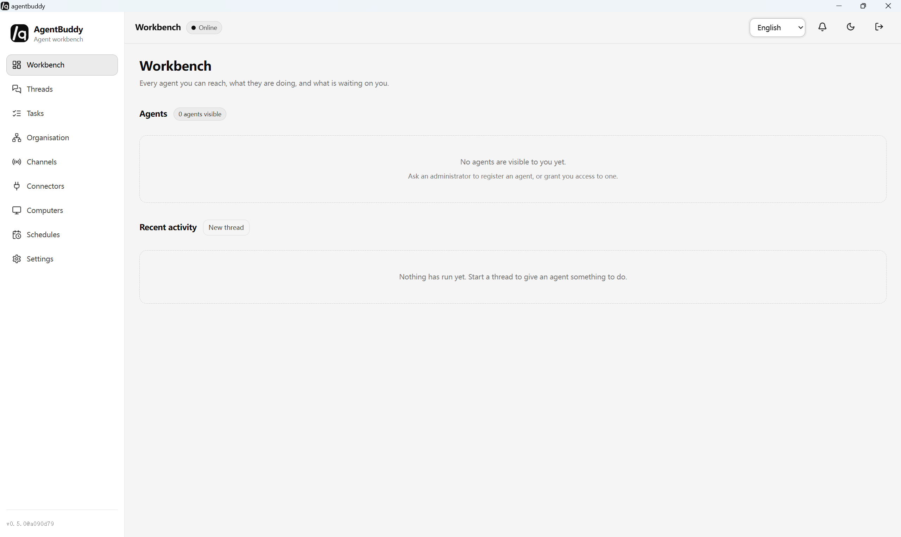

# agentbuddy

[English](README.md) | [中文](README_cn.md)

A desktop client for the [agenthub](https://github.com/ariacompute/agenthub) A2A
interconnection platform.

## Features

- Connect to any agenthub server by URL. The session lives in an HttpOnly cookie
  and is reused by the loopback proxy, so the workbench just talks same-origin.
- Agents, threads, task tracing, approvals (HITL park/resume), channels
  (Slack / Teams / Telegram / SMS webhooks), connectors (policy-gated actions),
  and voice (record → transcribe → delegate).

## Snapshot

The Workbench home screen — every agent you can reach, what they are doing,
and what is waiting on you:



## Develop

Prerequisites: [bun](https://bun.sh) 1.4+ and a Rust toolchain (edition 2021).

```bash
make web-dev      # vite dev server on :5173, proxies /api to localhost:3500
make desktop-dev  # run the shell against the freshly built console
make build        # console + a host-platform installer
```

Or build step by step with bun only (no `make`). The Tauri icons are derived
from `desktop/assets/app-icon.png` and live under `desktop/src-tauri/icons/`
(git-ignored build artefacts — see `.gitignore`), so run `bun run icons`
before `tauri build` / `tauri dev`:

```bash
cd web && bun install && bun run build  # build web/dist, embedded into the binary
cd desktop && bun install
bun run icons                           # derive Tauri icons from assets/app-icon.png
bun run build                           # tauri build for the host platform
# bun run dev                           # dev mode also needs `bun run icons` first
```

## Test

```bash
make test                           # web Vitest + desktop cargo tests, fully offline
cd web && bun run test              # Vitest: i18n completeness, monochrome guard, lib units
cd desktop/src-tauri && cargo test  # proxy / config / i18n units
```

## Release

Publishes installers through [`.github/workflows/release.yml`](.github/workflows/release.yml):

| Platform      | Portable                | Installer        |
| ------------- | ----------------------- | ---------------- |
| Linux x86_64  | `linux-x86_64.tar.gz`   | `amd64.deb`      |
| macOS aarch64 | `macos-aarch64.tar.gz`  | `aarch64.dmg`    |
| Windows x86_64| `windows-x86_64.zip`    | `x64.msi`        |

## Comparison

| Capability | agentbuddy | OpenDots | openmuse | openbot | Octop | openagents | Velozity |
|---|---|---|---|---|---|---|---|
| Form | Tauri v2 desktop + Vue 3 workbench | Web+Mobile template | RN/Expo/Web app | Electron desktop | Self-hosted single process | Agent collaboration OS | Cloud AI Office (SaaS) |
| Backend | agenthub (self-host) | CopilotKit runtime | CopilotKit runtime | Local agent CLIs | Octop Harness | Network SDK (self-host) | Closed cloud |
| Multi-agent | Roles via `persona` (F10) | Specialist Dots | Single personal agent | Many persistent agents | Expert teams + AgentTeams | Any agent in one workspace | User-built AI workforce |
| Computer use | Mock adapter `TODO(real)` (F11) | OpenBot container | Playwright browser | Computer Use (cua) | Browser AI+ / remote desktop | Shared browser | Not public |
| Human-in-loop | HITL park/resume (F4) | Approve & save/run | Review before send | Full access (preview) | Tool approval + PII redact | @mention / autonomous | Human + agent collab |
| Scheduling | Mock scheduler `TODO(real)` (F13) | Background turns | Goals & tracking | Webhook routines | Natural-language cron | Channel pickup | Smart scheduling |
| Skills / Knowledge | `kind=skill` + mock RAG (F14) | Auto-learn | — | Local skills | Company Brain | — | Company Brain |
| Channels | Slack / Teams / Telegram / SMS (F6) | Slack | Gmail / Calendar | Desktop / Mobile | IM omnichannel | Workspace threads | Chat + voice cabins |
| Voice | Record → transcribe → delegate (F8) | WebRTC calls | — | Mobile WebRTC | — | — | Voice / video cabins |
| Self-host | Yes (desktop + agenthub) | Docker | Docker / Render | Local / server | Single process | Self-host network | No (SaaS) |

## License

MIT.

## Engineering conventions

This repository follows Harness Engineering:

- [`AGENTS.md`](AGENTS.md): entry point and directory index for agent engineering context
- [`requirements.md`](requirements.md): requirement spec (scope / errors / acceptance, reviewed by a human before coding)
- [`task.md`](task.md): implementation checklist
