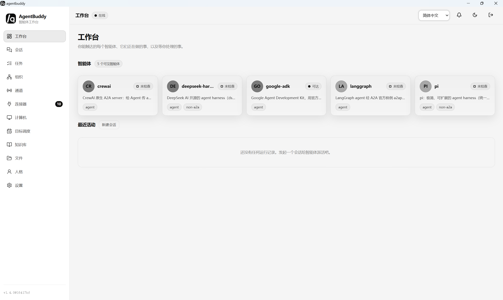
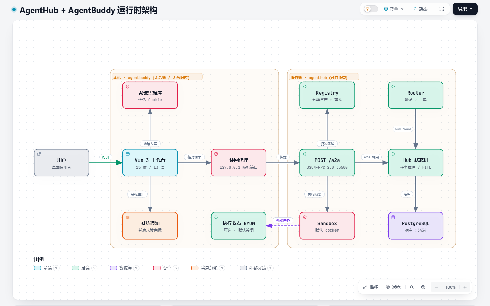

# agentbuddy

[English](README.md) | [中文](README_cn.md)

面向 [agenthub](https://github.com/ariacompute/agenthub)（A2A 互连平台）的桌面客户端。

## 功能

- 按 URL 连接任意 agenthub 服务端。会话保存在 HttpOnly Cookie 中，由环回代理复用，
  工作台始终以同源方式通信。
- Agent、会话线程、任务追踪、审批（HITL 挂起/恢复）、通道（Slack / Teams / Telegram / SMS
  webhook）、连接器（按策略放行的动作），以及语音（录音 → 转写 → 委派）。
- 自动更新：并发探测 GitHub 与 Gitee，取可用且最快的一源，失败自动切到另一源；启动即查、
  此后每天一次，按本地操作系统与 CPU 架构匹配签名安装包，一键验签升级后重启。设置里可关闭
  自动检查，也可跳过某个版本。

## 快照

工作台首页 —— 你可达的每个智能体、它们正在做的事、以及等待你处理的事项：



## 图示

三张可交互图分别说明运行时架构、一次 A2A 委派与任务状态机。每张都是单文件 HTML，
可在线打开；也可以 clone 仓库后直接打开 `docs/diagrams/` 里的文件，无需服务端，
离线效果一致。

| 图示 | 可交互 | 静态预览 |
| --- | --- | --- |
| 运行时架构 | [打开](https://ariacompute.github.io/agentbuddy/diagrams/agenthub-agentbuddy.architecture.html) | [PNG](diagrams/agenthub-agentbuddy.architecture.png) |
| 一次 A2A 委派（`message/send` → `tasks/resume`） | [打开](https://ariacompute.github.io/agentbuddy/diagrams/agenthub-agentbuddy.sequence.html) | [PNG](diagrams/agenthub-agentbuddy.sequence.png) |
| 任务状态机 | [打开](https://ariacompute.github.io/agentbuddy/diagrams/agenthub-agentbuddy.lifecycle.html) | [PNG](diagrams/agenthub-agentbuddy.lifecycle.png) |



## 开发

前置依赖：[bun](https://bun.sh) 1.4+ 与 Rust 工具链（edition 2021）。

```bash
make web-dev      # vite 开发服务器（:5173），/api 代理到 localhost:3500
make desktop-dev  # 用刚构建好的控制台启动外壳
make build        # 控制台 + 当前平台的安装包
```

也可完全用 bun 逐步构建（不依赖 make）。Tauri 图标由
`desktop/assets/app-icon.png` 派生，位于 `desktop/src-tauri/icons/`
（该目录已被 git 忽略，属构建产物，见 `.gitignore`），因此在执行
`tauri build` / `tauri dev` 前需先运行 `bun run icons`：

```bash
cd web && bun install && bun run build  # 构建 web/dist，编译期嵌入二进制
cd desktop && bun install
bun run icons                           # 从 assets/app-icon.png 派生 Tauri 图标
bun run build                           # 针对当前平台执行 tauri build
# bun run dev                           # 开发模式同样需先运行 bun run icons
```

## 测试

```bash
make test                           # 前端 Vitest + 发布脚本 Vitest + 桌面 cargo 测试，全程离线
cd web && bun run test              # Vitest：i18n 完整性、单色守卫、lib 单测
cd web && bun run test:coverage     # 同一批用例 + v8 覆盖率报告
cd desktop && bun run test          # 发布脚本：图标、版本戳、签名、latest.json
cd desktop && bun run test:coverage # 同一批用例 + v8 覆盖率报告（scripts/）
cd desktop/src-tauri && cargo test  # proxy / config / i18n 单测
make smoke                          # 两条跨进程冒烟（见下）
```

`make smoke` 跑那两条真正走 socket 的用例，且只连 `127.0.0.1`，不出机器：

- `make web-smoke`——真 `api.js` + Pinia store 对 `node:http` 桩：`refreshAll()` 打到每个端点、
  通知 POST 带本地化标题到达、401 记为 `authExpired`、连接被拒记为 `offline`（绝不误判为会话过期）。
- `make desktop-smoke`——真上游 `TcpListener` + 真 `axum::serve` 代理 + 真 `reqwest` 客户端：
  无 token → 401，bootstrap nonce → Cookie，`/api` 转发且上游 `Set-Cookie` 被重写，
  `/__shell/notify` 回机器码，外来 `Origin` → 403。

## 发布

通过 [`.github/workflows/release.yml`](.github/workflows/release.yml) 构建并发布安装包。
每次 release 恰好 9 个 assets：下表 6 个下载，加 `latest.json`、`latest-gitee.json`
与 `SHA256SUMS`。**不再发布**独立的签名更新包、`.sig` 或 `updater-*.json`。

| 平台          | 便携版                  | 安装包          |
| ------------- | ----------------------- | --------------- |
| Linux x86_64  | `linux-x86_64.tar.gz`   | `amd64.deb`     |
| macOS aarch64 | `macos-aarch64.tar.gz`  | `aarch64.dmg`   |
| Windows x86_64| `windows-x86_64.zip`    | `x64.msi`       |

### 签名更新（一次性配置）

```bash
cd desktop
bun install
mkdir -p ~/.tauri
bunx tauri signer generate -w ~/.tauri/agentbuddy.key
```

按提示输入口令，CLI 会打印公钥，并生成 `~/.tauri/agentbuddy.key`（私钥）与
`~/.tauri/agentbuddy.key.pub`。只有 Rust 工具链时也可 `cargo install tauri-cli --version '^2' --locked`
后用 `cargo tauri signer generate -w ~/.tauri/agentbuddy.key`。

三个值都放仓库 secrets。两个密钥文件本身就是**单行 base64**，直接取文件内容即可：

```bash
gh secret set UPDATER_PUBKEY < ~/.tauri/agentbuddy.key.pub
gh secret set TAURI_SIGNING_PRIVATE_KEY < ~/.tauri/agentbuddy.key
gh secret set TAURI_SIGNING_PRIVATE_KEY_PASSWORD
```

## 执行环境

「计算机」屏是执行环境控制台的只读视图：按隔离层分组的后端目录（容器 / 用户态内核 / microVM /
进程沙盒 / 平台层 / 远端节点 / off）、每一项的可用性与不可用原因、五指标水位条、带倒计时的租约卡片，
以及可试跑命令的审计抽屉。全部数据来自 agenthub——桌面端不探测运行时，也不自行判断哪种后端安全。

### 作为执行节点（可选，默认关闭）

设置 → **执行节点** 允许这台机器为服务端执行命令，限制由桌面端在本地强制：

- **不经 shell**——argv 直接执行，只接受白名单里精确匹配的命令名；
- **一个根目录**——配置的绝对路径之外不可读取、写入或执行；
- **有界**——unix 下超时终止**整棵进程组**（TERM → 250ms 宽限 → KILL，孙进程无法留下）、
  输出截断、并发数受限；Windows 没有进程组语义，退回只杀直接子进程并如实说明，不假装已清场；
- **可撤销**——关掉开关立即停止，服务端随即显示离线。

## 对比

| 能力 | agentbuddy | OpenDots | openmuse | openbot | Octop | openagents | Velozity |
|---|---|---|---|---|---|---|---|
| 形态 | Tauri v2 桌面 + Vue 3 工作台 | Web+移动模板 | RN/Expo/Web 应用 | Electron 桌面 | 自托管单进程 | Agent 协作 OS | 云端 AI Office（SaaS） |
| 后端 | agenthub（可自托管）| CopilotKit runtime | CopilotKit runtime | 本地 Agent CLI | Octop Harness | Network SDK（可自托管） | 闭源云端 |
| 多 Agent | 角色经 `persona`（F10） | 专用 Dots | 单一个人 Agent | 多个持久 Agent | 专家团队 + AgentTeams | 任意 Agent 同一工作区 | 用户自建 AI 劳动力 |
| 计算机使用 | 租约沙盒：docker（默认）、gVisor、Kata、bubblewrap、托管运行时或登记的节点（F17） | OpenBot 容器 | Playwright 浏览器 | Computer Use（cua） | Browser AI+ / 远程桌面 | 共享浏览器 | 未公开 |
| 人机协同 | HITL 挂起/恢复（F4） | Approve & save/run | 发送前审查 | 全权限（预览期） | 工具审批 + PII 脱敏 | @提及 / 自主认领 | 人类 + Agent 协作 |
| 调度 | 触发路由器：cron / 会话 / 渠道 / 手动 → 规则 → 批量语义判定 → 工单 → 执行者（F13） | 后台回合 | 目标与监控 | Webhook 例程 | 自然语言 Cron | 频道认领 | 智能排程 |
| 技能 / 知识库 | `kind=skill` + mock RAG（F14） | 自动学习 | — | 本地技能 | Company Brain | — | Company Brain |
| 通道 | Slack / Teams / Telegram / SMS（F6） | Slack | Gmail / Calendar | 桌面 / 移动 | IM 全渠道 | 工作区线程 | 聊天 + 语音舱 |
| 语音 | 录音 → 转写 → 委派（F8） | WebRTC 通话 | — | 移动端 WebRTC | — | — | 语音 / 视频舱 |
| 执行隔离 | 服务端租约；本桌面也可作为节点（BYOM） | — | — | — | — | — | — |
| 自托管 | 是（桌面 + agenthub） | Docker | Docker / Render | 本地 / 服务器 | 单进程 | 自托管网络 | 否（SaaS） |

## 许可证

MIT.

## 工程约定

本仓库遵循 Harness Engineering：

- [`AGENTS.md`](AGENTS.md)：Agent 工程上下文入口与目录索引
- [`requirements.md`](requirements.md)：需求规格（功能边界 / 异常 / 验收，人审后编码）
- [`task.md`](task.md)：实施清单
